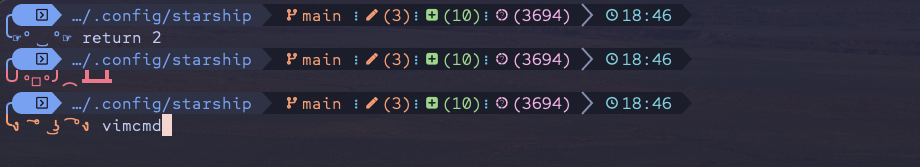

# starship-tableflip

My (╯°□°）╯︵┻━┻ prompt for [starship](https://starship.rs), themed live by [Omarchy](https://omarchy.org).



## How it works

This is an Omarchy *themed template*, not a shell plugin (those are Quickshell
bar widgets). `starship.toml.tpl` is dropped into `~/.config/omarchy/themed/`,
where Omarchy renders its `{{ color }}` palette tokens from the active theme's
`colors.toml` on every `omarchy theme set` — so the prompt restyles itself
whenever you switch themes. `~/.config/starship.toml` points at the rendered
output in `~/.local/state/omarchy/current/theme/starship.toml`.

Styles reference the generic palette names (`fg:accent`, `bg:dark_background`,
`fg:muted`, ...) rather than any one theme's color names, so the config works
with every Omarchy theme and the palette section doubles as an overview of the
tokens you can use while tweaking.

## Requirements

- [Omarchy](https://omarchy.org) (ships starship and a Nerd Font by default)

## Install

```bash
git clone https://github.com/d34dh0r53/starship-tableflip.git
cd starship-tableflip
./install.sh
```

`install.sh`:

- backs up your existing `~/.config/starship.toml` (as `starship.toml.bak.<epoch>`)
- links `starship.toml.tpl` into `~/.config/omarchy/themed/` (use `./install.sh --copy` to copy instead)
- links `~/.config/starship.toml` to the rendered theme output
- runs `omarchy theme refresh` so it applies immediately

## Update

```bash
git pull && ./install.sh
```

With the default symlink install, template changes apply on the next
`omarchy theme set` (or `omarchy theme refresh`); a `--copy` install needs the
re-run of `install.sh`.

## Uninstall

```bash
./uninstall.sh
```

Removes the template and the `~/.config/starship.toml` link, then restores the
stock Omarchy prompt via `omarchy refresh config starship.toml`. Install-time
backups are left in `~/.config/` if you want your old config back instead.
